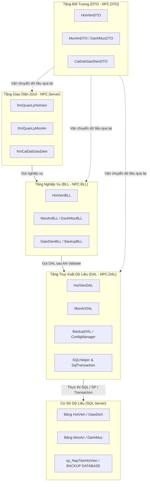

# Kế Hoạch Triển Khai Xử Lý Sự Kiện 3 Form (Hội Viên, Món Ăn, Cài Đặt Giao Diện) Theo Kiến Trúc 4 Lớp Chuẩn

---

## 1. Mục Tiêu & Bối Cảnh (Goal Description)
Hiện tại, nhánh `master` đã có sẵn giao diện thiết kế hoàn chỉnh (kéo thả bằng Windows Forms Designer trong Visual Studio) của 3 màn hình nghiệp vụ trọng tâm:
1. **`frmQuanLyHoiVien`**: Quản lý hồ sơ hội viên, tìm kiếm, thêm, sửa, xóa, nạp tiền nhanh vào tài khoản, xuất báo cáo danh sách.
2. **`frmQuanLyMonAn`**: Quản lý thực đơn và kiểm kê kho hàng, phân loại món, giá nhập/bán, tồn kho, hình ảnh món ăn, cảnh báo sắp hết hàng.
3. **`frmCaiDatGiaoDien`**: Cài đặt tùy biến màu sắc trạng thái máy phòng nét (Trống, Đang chơi, Bảo trì), font chữ hiển thị, cấu hình sao lưu (`BACKUP DATABASE`) & phục hồi (`RESTORE DATABASE`) SQL Server.

Mục tiêu của kế hoạch này là **xây dựng hoàn chỉnh tầng DTO, DAL, BLL và đấu nối sự kiện vào GUI** theo đúng phong cách **kéo thả Toolbox** và quy chuẩn:
- **Tầng DTO (Data Transfer Object)**: Định nghĩa các class mô hình hóa thực thể: `HoiVienDTO`, `MonAnDTO`, `DanhMucDTO`, `CaiDatGiaoDienDTO`.
- **Tầng DAL (Data Access Layer)**: Kết nối CSDL thông qua `SQLHelper` và `SqlConnection`, thực thi các truy vấn tham số hóa (Parameterized Queries) và Stored Procedures (`sp_NapTienHoiVien`, `sp_TopupMemberBalance`), bảo đảm chống SQL Injection.
- **Tầng BLL (Business Logic Layer)**: Đảm nhận kiểm tra quy tắc nghiệp vụ (Validate dữ liệu, kiểm tra trùng tên đăng nhập, số dư tối thiểu, tồn kho không âm, bọc `SqlTransaction` khi nạp tiền/nhập kho).
- **Tầng GUI (Form)**: Đấu nối các sự kiện Click button, CellClick DataGridView, TextChanged tìm kiếm, ComboBox SelectedIndexChanged đúng chuẩn sinh tự động của Designer trong Visual Studio.

---

## 2. Điểm Cần Người Dùng Phê Duyệt (User Review Required)

> [!IMPORTANT]
> **Về Nạp tiền Hội viên & Bọc SqlTransaction:**
> Trong nhánh `master` mới pull về, project đã có sẵn class [GiaoDichBLL.cs](file:///d:/LapTrinhWin_DoAn/NPC.BLL/GiaoDichBLL.cs) và [GiaoDichDAL.cs](file:///d:/LapTrinhWin_DoAn/NPC.DAL/GiaoDichDAL.cs) xử lý nạp tiền bằng `SqlTransaction` và SP `sp_NapTienHoiVien`. Chúng ta sẽ tái sử dụng hoặc mở rộng trực tiếp cơ chế này vào nút `btnNapTien` của `frmQuanLyHoiVien` để đảm bảo tính đồng bộ kiến trúc toàn dự án.

> [!WARNING]
> **Quyền Sao lưu / Phục hồi Database (`BACKUP` / `RESTORE`):**
> Trong `frmCaiDatGiaoDien`, tính năng sao lưu và phục hồi CSDL đòi hỏi tài khoản SQL Server phải có quyền `sysadmin` hoặc `db_backupoperator`, đồng thời thư mục sao lưu phải cho phép tiến trình SQL Server (Service Account) ghi file `.bak`. Chúng ta sẽ cung cấp cơ chế chọn thư mục an toàn và bọc `try-catch` hiển thị thông báo chi tiết.

---

## 3. Kiến Trúc 4 Lớp & Luồng Dữ Liệu (Architecture Overview)



---

## 4. Chi Tiết Kế Hoạch Từng Phân Hệ

### PHÂN HỆ 1: QUẢN LÝ HỘI VIÊN (`frmQuanLyHoiVien`)

#### 1. DTO Layer:
- **`NPC.DTO/HoiVienDTO.cs`**:
  - `MaHoiVien` (int), `TenDangNhap` (string), `MatKhau` (string), `HoTen` (string), `DienThoai` (string), `SoDu` (decimal), `TongThoiGianChoi` (int), `NgayTao` (DateTime), `TrangThai` (string: "Hoạt động", "Bị khóa", "Đang chơi").

#### 2. DAL Layer:
- **`NPC.DAL/HoiVienDAL.cs`**:
  - `GetDanhSachHoiVien(string tuKhoa, string trangThai)`: Lấy dữ liệu hiển thị DataGridView, dùng `SQLHelper.ExecuteQuery`.
  - `ThemHoiVien(HoiVienDTO hv)`: Thêm mới hội viên, mật khẩu mã hóa BCrypt.
  - `CapNhatHoiVien(HoiVienDTO hv)`: Cập nhật họ tên, điện thoại, trạng thái.
  - `XoaHoiVien(int maHoiVien)`: Xóa hội viên (hoặc chuyển trạng thái ngừng hoạt động nếu đã phát sinh giao dịch).
  - `KiemTraTrungTenDangNhap(string tenDangNhap, int? maHoiVienHienTai)`: Đảm bảo Unique.

#### 3. BLL Layer:
- **`NPC.BLL/HoiVienBLL.cs`**:
  - Kiểm tra tính hợp lệ: Tên đăng nhập không được chứa ký tự đặc biệt, mật khẩu tối thiểu 6 ký tự, số điện thoại chuẩn 10 số.
  - `NapTien(int maHoiVien, decimal soTien, int maNhanVien, string hinhThuc)`: Gọi `GiaoDichBLL.NapTien` bọc `SqlTransaction`, ghi chép bảng `GiaoDich` và cộng số dư `HoiVien.SoDu`.

#### 4. GUI Layer (`frmQuanLyHoiVien.cs`):
- **Sự kiện Form & Grid:**
  - `frmQuanLyHoiVien_Load`: Nạp dữ liệu vào `cboTrangThai` và hiển thị danh sách lên `dgvHoiVien`. Tính tổng số hội viên và tổng số dư hiển thị lên `lblTongSoHoiVien`, `lblTongSoDu`.
  - `dgvHoiVien_CellClick`: Đổ dữ liệu từ dòng được chọn lên các TextBox (`txtMaHoiVien`, `txtHoTen`, `txtMatKhau`, `txtDienThoai`, `txtSoDu`, `cboTrangThai`).
- **Sự kiện Chức năng (Buttons):**
  - `btnThem_Click`: Validate thông tin -> Gọi `HoiVienBLL.ThemHoiVien()`.
  - `btnSua_Click`: Xác nhận sửa thông tin hội viên đã chọn.
  - `btnXoa_Click`: Hộp thoại xác nhận (Yes/No) -> Xóa hội viên.
  - `btnNhapLai_Click`: Xóa trắng các TextBox trên form để chuẩn bị thêm mới.
  - `btnNapTien_Click`: Bật popup nhỏ hỏi số tiền cần nạp -> Gọi BLL nạp tiền bọc Transaction.
  - `btnTimKiem_Click` & `txtTimKiem_TextChanged`: Tìm kiếm trực tiếp theo Tên đăng nhập hoặc Họ tên.
  - `btnXuatFile_Click`: Sử dụng `SaveFileDialog` xuất danh sách hội viên ra file CSV / Excel.
  - `btnDong_Click`: Đóng form.

---

### PHÂN HỆ 2: QUẢN LÝ THỰC ĐƠN & KHO HÀNG (`frmQuanLyMonAn`)

#### 1. DTO Layer:
- **`NPC.DTO/DanhMucDTO.cs`**:
  - `MaDanhMuc` (int), `TenDanhMuc` (string).
- **`NPC.DTO/MonAnDTO.cs`**:
  - `MaMon` (int), `MaDanhMuc` (int), `TenDanhMuc` (string), `TenMon` (string), `DonGia` (decimal), `GiaNhap` (decimal), `SoLuongTon` (int), `DonViTinh` (string), `HinhAnh` (string), `ConPhucVu` (bool), `TrangThaiText` (string).

#### 2. DAL Layer:
- **`NPC.DAL/MonAnDAL.cs`**:
  - `GetDanhSachMonAn(string tuKhoa, int? maDanhMuc, bool chiLayTonKhoThap)`: Truy vấn `MonAn` JOIN `DanhMuc`.
  - `GetDanhSachDanhMuc()`: Lấy danh sách danh mục đổ vào `cboLoaiMon` và `cboTimKiemLoai`.
  - `ThemMonAn(MonAnDTO mon)`
  - `CapNhatMonAn(MonAnDTO mon)`
  - `XoaMonAn(int maMon)`
  - `NhapKhoMonAn(int maMon, int soLuongThem, decimal giaNhap)`: Bọc `SqlTransaction` cập nhật tồn kho.

#### 3. BLL Layer:
- **`NPC.BLL/MonAnBLL.cs`**:
  - Kiểm tra: Tên món không được để trống, Đơn giá bán phải lớn hơn hoặc bằng Giá nhập, Số lượng tồn không được âm.
  - Tự động phát hiện cảnh báo: Nếu tồn kho `< 5` thì đánh dấu trạng thái "Sắp hết hàng".

#### 4. GUI Layer (`frmQuanLyMonAn.cs`):
- **Sự kiện Form & Grid:**
  - `frmQuanLyMonAn_Load`: Tải ComboBox danh mục, nạp dữ liệu vào `dgvMonAn`, tính tổng số món và tổng tồn kho.
  - `dgvMonAn_CellClick`: Hiển thị thông tin lên TextBox và load hình ảnh món ăn vào `picHinhAnh` (nếu có file ảnh).
- **Sự kiện Hình ảnh & Chức năng:**
  - `btnChonAnh_Click`: Dùng `OpenFileDialog` cho phép chọn ảnh (.jpg, .png) -> Copy ảnh vào thư mục `Resources/Images/` của ứng dụng và hiển thị lên `picHinhAnh`.
  - `btnXoaAnh_Click`: Xóa ảnh đại diện hiện tại.
  - `btnThem_Click`, `btnSua_Click`, `btnXoa_Click`, `btnNhapLai_Click`.
  - `btnNhapKho_Click`: Mở hộp thoại nhập thêm số lượng tồn kho.
  - `chkTonKhoThap_CheckedChanged`: Lọc nhanh các món sắp hết hàng.

---

### PHÂN HỆ 3: CÀI ĐẶT GIAO DIỆN & SAO LƯU HỆ THỐNG (`frmCaiDatGiaoDien`)

#### 1. DTO & Config:
- **`NPC.DTO/GiaoDienConfigDTO.cs`**:
  - `ColorMayTrong` (Color), `ColorDangChoi` (Color), `ColorBaoTri` (Color), `FontHienThi` (Font).
- Lưu trữ cấu hình: Đọc/ghi cấu hình màu sắc và font ra file `appsettings.json` hoặc sử dụng class [ConfigManager.cs](file:///d:/LapTrinhWin_DoAn/NPC.DAL/ConfigManager.cs) có sẵn.

#### 2. DAL & BLL Layer:
- **`NPC.DAL/BackupDAL.cs` & `NPC.BLL/HeThongBLL.cs`**:
  - `ThucHienSaoLuu(string duongDanFileBak)`: Thực thi câu lệnh T-SQL `BACKUP DATABASE [NPCData] TO DISK = @DuongDan WITH FORMAT, INIT;`.
  - `ThucHienPhucHoi(string duongDanFileBak)`: Đóng kết nối hiện tại, chuyển DB sang Single User mode và thực thi `RESTORE DATABASE`.

#### 3. GUI Layer (`frmCaiDatGiaoDien.cs`):
- **Cài đặt màu sắc & Font:**
  - `btnDoiMauTrong_Click`, `btnDoiMauDangChoi_Click`, `btnDoiMauBaoTri_Click`: Dùng `ColorDialog` để người dùng chọn màu tùy ý -> Cập nhật màu lên các Panel màu mẫu và vùng xem trước (`pnlPereviewMay`).
  - `btnChonFont_Click`: Dùng `FontDialog` để chọn font chữ toàn hệ thống.
  - `btnLuuCaiDat_Click`: Lưu cấu hình vào file và áp dụng ngay lập tức cho các Form con.
  - `btnMacDinh_Click`: Khôi phục màu mặc định (Xanh dương, Xanh lá, Vàng cam, font Segoe UI).
- **Sao lưu & Phục hồi:**
  - `btnChonThuMuc_Click`: Mở `FolderBrowserDialog` chọn nơi lưu file sao lưu.
  - `btnSaoLuu_Click`: Chạy sao lưu thông qua `BackgroundWorker` để không bị đơ giao diện (`UI Freezing`), đồng thời thanh `prgTienTrinh` chạy từ 0 đến 100%.
  - `btnKhoiPhuc_Click`: Mở `OpenFileDialog` chọn file `.bak` để phục hồi CSDL.

---

## 5. Kế Hoạch Xác Minh & Kiểm Thử (Verification Plan)

### Kiểm thử Tự Động (Automated Build Check):
- Chạy lệnh build đảm bảo toàn bộ Solution biên dịch 100% không lỗi:
  ```powershell
  dotnet build D:\LapTrinhWin_DoAn\NPC_Management.slnx
  ```

### Kiểm thử Thủ Công (Manual Verification):
1. **Form Hội Viên:**
   - Thêm hội viên mới -> Kiểm tra dữ liệu xuất hiện ngay trên `dgvHoiVien`.
   - Bấm Nạp tiền 50.000đ -> Kiểm tra số dư tăng lên, bảng `GiaoDich` phát sinh 1 dòng giao dịch nạp tiền.
   - Thử nhập trùng Tên đăng nhập -> Hệ thống cảnh báo và từ chối thêm.
2. **Form Món Ăn:**
   - Thêm món ăn mới kèm hình ảnh -> Món ăn hiển thị đúng ảnh và giá trên Grid.
   - Check vào "Tồn kho thấp" -> Grid chỉ lọc ra các món có số lượng `< 5`.
3. **Form Cài Đặt Giao Diện:**
   - Đổi màu trạng thái -> Vùng Preview đổi màu theo.
   - Bấm Sao lưu CSDL -> File `.bak` sinh ra đúng thư mục đã chọn, thanh ProgressBar chạy hoàn tất.
