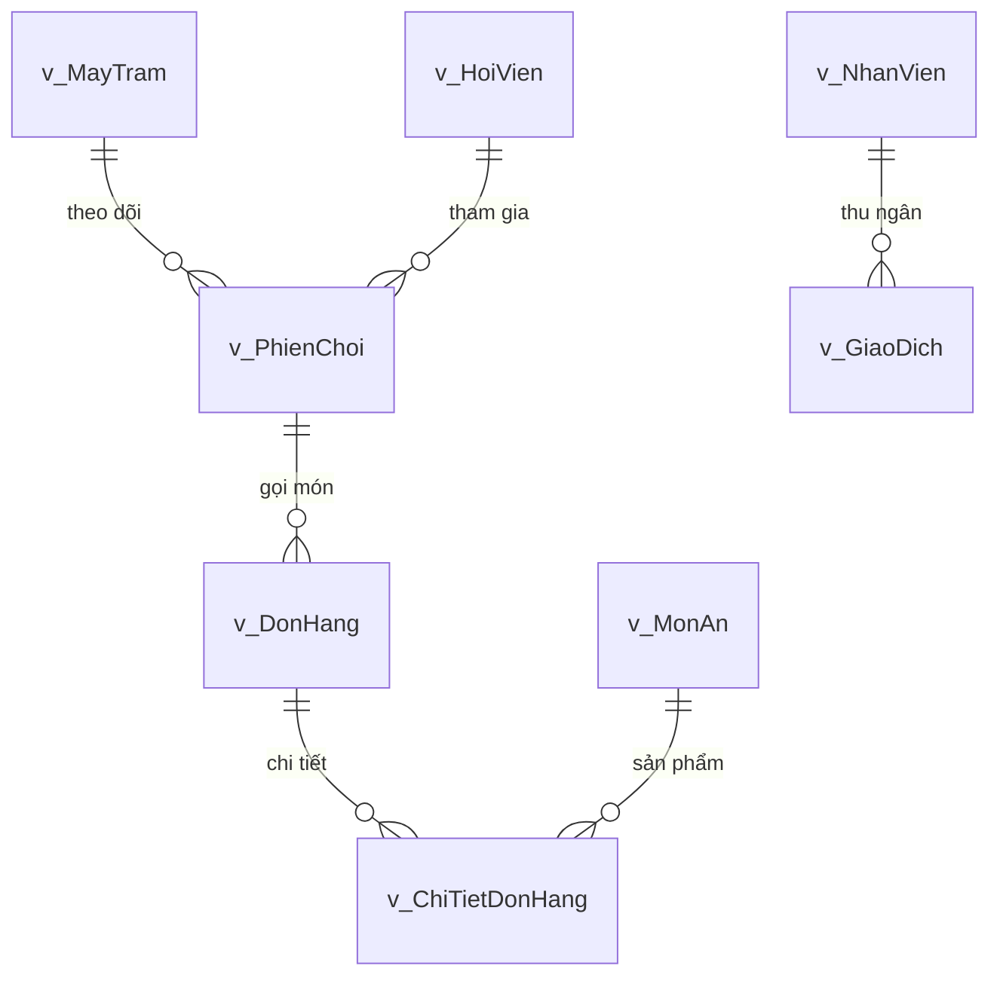

# Kế hoạch Chuẩn hóa Toàn diện CSDL SQL Server sang 100% Tiếng Việt

## Mô tả mục tiêu (Goal Description)
Chuẩn hóa toàn diện hệ thống Cơ sở Dữ liệu (CSDL) `NPCData` sang **100% Tiếng Việt**:
1. **Chuyển đổi các View tương thích sang Tiếng Việt**:
   - Thay thế các View tiếng Anh cũ (`Employees`, `Members`, `Computers`...) bằng hệ thống **Views nghiệp vụ Tiếng Việt có tiền tố `v_`** trực quan, kết hợp dữ liệu bảng cha - bảng con (VD: `v_NhanVien`, `v_MayTram`, `v_HoiVien`, `v_MonAn`, `v_DonHang`, `v_ChiTietDonHang`, `v_PhienChoi`, `v_GiaoDich`).
2. **Chuẩn hóa toàn bộ Dữ liệu Trạng thái trong Database sang 100% Tiếng Việt**:
   - **Trạng thái máy trạm (`MayTram.TrangThai`)**: Chuyển từ `'Online'`, `'Offline'`, `'InUse'`, `'Locked'` ➔ `N'Sẵn sàng'`, `N'Tắt máy'`, `N'Đang dùng'`, `N'Bảo trì'` (khớp 100% với màu sắc và yêu cầu trong đề án: Xanh lá = Sẵn sàng, Đỏ = Đang dùng, Vàng = Bảo trì, Xám = Tắt máy).
   - **Trạng thái phiên chơi (`PhienChoi.TrangThaiPhien`)**: Chuyển từ `'Active'`, `'Ended'` ➔ `N'Đang chơi'`, `N'Đã kết thúc'`.
   - **Trạng thái đơn hàng F&B (`DonHang.TrangThai`)**: Chuyển từ `'Pending'`, `'Preparing'`, `'Delivered'`, `'Cancelled'` ➔ `N'Chờ duyệt'`, `N'Đang làm'`, `N'Đã giao'`, `N'Đã hủy'`.
   - **Trạng thái tài khoản hội viên (`HoiVien.TrangThai`)**: `N'Hoạt động'`, `N'Đang chơi'`, `N'Bị khóa'`.
   - **Hình thức thanh toán (`GiaoDich.HinhThucThanhToan`)**: `N'Tiền mặt'`, `N'Chuyển khoản VietQR'`.
3. **Cập nhật đồng bộ các Triggers & Stored Procedures**:
   - Điều chỉnh điều kiện kiểm tra trong `trg_KiemTraTrangThaiMay` (`N'Đang dùng'`), `trg_TruTonKhoKhiGiaoHang` (`N'Đã giao'`).
   - Cập nhật logic trong `sp_MoPhienChoi` và `sp_KetThucPhienChoi` để gán và kiểm tra đúng trạng thái tiếng Việt.
4. **Cập nhật đồng bộ tầng Ứng dụng C# (`frmDangNhapServer.cs`)**:
   - Chuyển câu truy vấn đăng nhập sang bảng tiếng Việt: `SELECT MatKhau FROM NhanVien WHERE TenDangNhap = @TenDangNhap` (hoặc View `v_NhanVien`).

---

## Cần người dùng xem xét (User Review Required)

> [!IMPORTANT]
> **Quy chuẩn Trạng thái Máy trạm (khớp với Sơ đồ phòng máy WinForms)**:
> - `N'Sẵn sàng'`: Máy đang bật, sẵn sàng cho khách vào chơi (Hiển thị icon Xanh lá).
> - `N'Đang dùng'`: Máy đang có phiên chơi hoạt động (Hiển thị icon Đỏ).
> - `N'Tắt máy'`: Máy chưa bật nguồn (Hiển thị icon Xám).
> - `N'Bảo trì'`: Máy đang hỏng hoặc tạm khóa kỹ thuật (Hiển thị icon Vàng).

> [!NOTE]
> **Hỗ trợ tương thích ngược (Backward Compatibility)**:
> Để tránh làm gián đoạn code của các thành viên khác đang viết dở (nếu có ai gọi `SELECT ... FROM Employees`), script sẽ đồng thời hỗ trợ cả View tiếng Anh phụ trợ song song với các View tiếng Việt chính.

---

## Danh sách Bảng, Cột và Trạng thái Chuẩn hóa Tiếng Việt

### 1. Bảng Trạng thái Dữ liệu (Status Normalization)

| Bảng CSDL | Cột trạng thái | Giá trị cũ (Tiếng Anh) | Giá trị mới chuẩn hóa (100% Tiếng Việt) |
| :--- | :--- | :--- | :--- |
| `MayTram` | `TrangThai` | `'Online'`, `'Offline'`, `'InUse'`, `'Locked'` | **`N'Sẵn sàng'`**, **`N'Tắt máy'`**, **`N'Đang dùng'`**, **`N'Bảo trì'`** |
| `PhienChoi` | `TrangThaiPhien` | `'Active'`, `'Ended'` | **`N'Đang chơi'`**, **`N'Đã kết thúc'`** |
| `DonHang` | `TrangThai` | `'Pending'`, `'Preparing'`, `'Delivered'`, `'Cancelled'` | **`N'Chờ duyệt'`**, **`N'Đang làm'`**, **`N'Đã giao'`**, **`N'Đã hủy'`** |
| `HoiVien` | `TrangThai` | `'Active'`, `'Locked'`, `'InUse'` | **`N'Hoạt động'`**, **`N'Bị khóa'`**, **`N'Đang chơi'`** |

---

### 2. Danh sách Hệ thống Views Nghiệp Vụ Tiếng Việt Mới



1. **`v_NhanVien`**:
   - Nối `NhanVien` + `VaiTro`.
   - Cột: `MaNhanVien`, `TenDangNhap`, `MatKhau`, `HoTen`, `SoDienThoai`, `MaVaiTro`, `TenVaiTro`, `TrangThai`.
2. **`v_MayTram`**:
   - Nối `MayTram` + `KhuVucPhong`.
   - Cột: `MaMay`, `TenMay`, `DiaChiIP`, `DiaChiMAC`, `MaPhong`, `TenPhong`, `DonGiaGio`, `TrangThai`.
3. **`v_HoiVien`**:
   - Lấy `HoiVien` kèm định dạng tiền và trạng thái.
   - Cột: `MaHoiVien`, `TenDangNhap`, `MatKhau`, `HoTen`, `SoDu`, `TongThoiGianChoi`, `NgayTao`, `TrangThai`.
4. **`v_MonAn`**:
   - Nối `MonAn` + `DanhMuc`.
   - Cột: `MaMon`, `MaDanhMuc`, `TenDanhMuc`, `TenMon`, `DonGia`, `SoLuongTon`, `HinhAnh`, `ConPhucVu`.
5. **`v_DonHang`**:
   - Nối `DonHang` + `MayTram`.
   - Cột: `MaDonHang`, `MaPhienChoi`, `MaMay`, `TenMay`, `ThoiGianDat`, `TongTien`, `TrangThai`.
6. **`v_ChiTietDonHang`**:
   - Nối `ChiTietDonHang` + `MonAn`.
   - Cột: `MaChiTiet`, `MaDonHang`, `MaMon`, `TenMon`, `SoLuong`, `DonGia`, `ThanhTien`.
7. **`v_PhienChoi`**:
   - Nối `PhienChoi` + `MayTram` + `HoiVien`.
   - Cột: `MaPhienChoi`, `MaMay`, `TenMay`, `MaHoiVien`, `TenHoiVien`, `ThoiGianBatDau`, `ThoiGianKetThuc`, `TongPhutChoi`, `GiaGioApDung`, `TienGio`, `TrangThaiPhien`.
8. **`v_GiaoDich`**:
   - Nối `GiaoDich` + `HoiVien` + `NhanVien`.
   - Cột: `MaGiaoDich`, `MaHoiVien`, `TenHoiVien`, `MaNhanVien`, `TenThuNgan`, `SoTien`, `HinhThucThanhToan`, `NgayGiaoDich`, `GhiChu`.

---

## Chi tiết Đề xuất Thay đổi (Proposed Changes)

### 1. Tệp kịch bản CSDL: `Database/NPCDB.sql` & `NPC.DAL/Database/NPCDB.sql`
- **Default Constraints**:
  - `MayTram.TrangThai`: `DEFAULT N'Tắt máy'`
  - `PhienChoi.TrangThaiPhien`: `DEFAULT N'Đang chơi'`
  - `DonHang.TrangThai`: `DEFAULT N'Chờ duyệt'`
- **Trigger `trg_KiemTraTrangThaiMay`**:
  - Kiểm tra `m.TrangThai = N'Đang dùng'` và `p.TrangThaiPhien = N'Đang chơi'`.
- **Trigger `trg_TruTonKhoKhiGiaoHang`**:
  - Kiểm tra `i.TrangThai = N'Đã giao'` và `d.TrangThai <> N'Đã giao'`.
- **Stored Procedure `sp_MoPhienChoi`**:
  - Cập nhật `MayTram.TrangThai = N'Đang dùng'`.
  - Cập nhật `HoiVien.TrangThai = N'Đang chơi'`.
  - Chèn `PhienChoi.TrangThaiPhien = N'Đang chơi'`.
- **Stored Procedure `sp_KetThucPhienChoi`**:
  - Cập nhật `PhienChoi.TrangThaiPhien = N'Đã kết thúc'`.
  - Cập nhật `MayTram.TrangThai = N'Sẵn sàng'`.
  - Cập nhật `HoiVien.TrangThai = N'Hoạt động'`.
- **Stored Procedure `sp_BaoCaoDoanhThu`**:
  - Lọc `PhienChoi.TrangThaiPhien = N'Đã kết thúc'`.
  - Lọc `DonHang.TrangThai = N'Đã giao'`.
- **Seed Data Tiếng Việt**:
  - `MayTram`: Cập nhật 8 máy `N'Sẵn sàng'`, 2 máy `N'Tắt máy'`.
  - `HoiVien`: Cập nhật trạng thái `N'Hoạt động'`, `N'Bị khóa'`.

### 2. Tệp Ứng dụng: `NPC.Server/frmDangNhapServer.cs`
- Cập nhật câu truy vấn kiểm tra đăng nhập:
  ```csharp
  string query = "SELECT MatKhau FROM NhanVien WHERE TenDangNhap = @TenDangNhap";
  object result = SQLHelper.ExecuteScalar(query, new SqlParameter("@TenDangNhap", tenDangNhap));
  ```

---

## Kế hoạch Kiểm thử & Xác minh (Verification Plan)

### 1. Kiểm thử Tự động CSDL qua `sqlcmd`
1. Thực thi script `Database/NPCDB.sql` trên `(localdb)\MSSQLLocalDB`.
2. Chạy kịch bản kiểm thử:
   - Truy vấn 8 Views tiếng Việt (`v_NhanVien`, `v_MayTram`, `v_HoiVien`, `v_MonAn`, `v_DonHang`, `v_ChiTietDonHang`, `v_PhienChoi`, `v_GiaoDich`) -> Xác nhận dữ liệu hiển thị đúng chuẩn.
   - Mở phiên chơi bằng `sp_MoPhienChoi` -> Xác nhận máy chuyển sang `N'Đang dùng'`, phiên chuyển `N'Đang chơi'`.
   - Gọi Trigger kiểm tra trùng máy -> Xác nhận chặn đúng khi máy đang `N'Đang dùng'`.
   - Tạo đơn hàng và chuyển trạng thái sang `N'Đã giao'` -> Xác nhận trigger trừ tồn kho kích hoạt chính xác.
   - Kết thúc phiên chơi bằng `sp_KetThucPhienChoi` -> Xác nhận máy trả về `N'Sẵn sàng'`, phiên chuyển `N'Đã kết thúc'`.

### 2. Kiểm thử Tích hợp Ứng dụng C#
- Biên dịch lại toàn bộ Solution `NPC_Management` -> Đảm bảo `0 Warning, 0 Error`.
- Kiểm tra tính tương thích giữa DAL và các View / Table mới.

