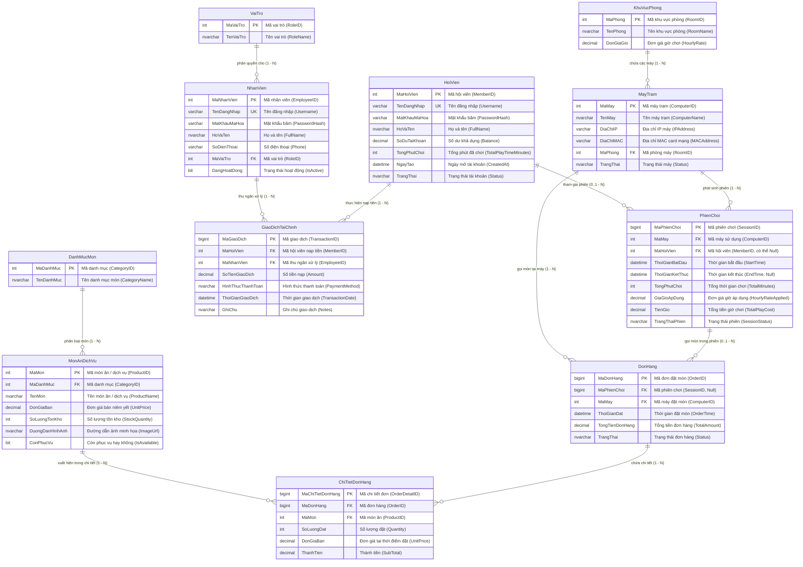

# Kế hoạch Thiết kế và Cài đặt CSDL SQL Server Chuẩn 3NF (`NPCData` / `NPCDB`)

## Mô tả mục tiêu (Goal Description)
Xây dựng và cài đặt hệ thống Cơ sở Dữ liệu (CSDL) **NPC Management** trên nền tảng **SQL Server / LocalDB** đạt chuẩn **Dạng chuẩn 3 (3NF)**:
1. **11 Bảng thực thể chuẩn 3NF**: Phản ánh trọn vẹn 3 luồng dữ liệu (Data Flows) cốt lõi của đề án:
   - *Luồng Quản lý Máy & Phiên chơi* (`ComputerRooms`, `Computers`, `Sessions`).
   - *Luồng Tài chính & Hội viên* (`Roles`, `Employees`, `Members`, `Transactions`).
   - *Luồng Dịch vụ F&B & Kho* (`Categories`, `Products`, `Orders`, `OrderDetails`).
2. **Bộ 4 Triggers tự động bảo vệ dữ liệu (Fool-Proof Triggers)**:
   - `trg_CheckComputerStatus`: Chống mở trùng máy (ngăn 2 người cùng mở 1 máy trạm).
   - `trg_PreventNegativeStock`: Chống xuất âm kho ngay khi thêm/sửa món trong chi tiết đơn hàng.
   - `trg_AutoUpdateTotalAmount`: Tự động tính toán và cập nhật `TotalAmount` của đơn hàng khi chi tiết đơn thay đổi.
   - `trg_UpdateStockAfterOrder`: Tự động trừ số lượng tồn kho `StockQuantity` trong bảng `Products` khi đơn chuyển sang `'Delivered'`.
3. **User-Defined Function (UDF)**:
   - `fn_CalculateSessionCost`: Tính tiền giờ linh hoạt từ thời gian bắt đầu, kết thúc và đơn giá giờ, xử lý làm tròn phút chuẩn quán nét.
4. **Bộ Stored Procedures bọc Transaction (ACID)**:
   - `sp_StartSession`: Mở máy cho hội viên hoặc khách vãng lai, kiểm tra số dư tối thiểu, cập nhật trạng thái máy sang `'InUse'`.
   - `sp_EndSession`: Chốt phiên chơi, tính tiền giờ qua `fn_CalculateSessionCost`, trừ số dư hội viên, cập nhật thời gian chơi và giải phóng máy về `'Online'`.
   - `sp_TopupMemberBalance`: Nạp tiền tài khoản hội viên, cộng số dư và ghi vết vào `Transactions`.
   - `sp_GetRevenueReport`: Truy vấn tổng hợp doanh thu tiền giờ, đồ ăn và nạp tiền trong khoảng ngày, phục vụ kết xuất trực tiếp vào form Crystal Report (`frmBaoCaoCrystalReport.cs`).
5. **Dữ liệu mẫu khởi tạo chuẩn hóa (Seed Data)**: Đầy đủ phòng máy, máy trạm, danh mục món ăn, tồn kho, hội viên và tài khoản quản trị `admin` (mật khẩu `121212` băm BCrypt tương thích Form đăng nhập).
6. **Đóng gói file script & hướng dẫn**: Tạo file kịch bản CSDL hoàn chỉnh `Database/NPCDB.sql` để mang đi chấm thi hoặc triển khai tự động.

---

## Phân tích Kiểm tra Chuẩn 3NF (Normalization Verification)

Hệ thống thiết kế gồm 11 bảng đáp ứng đầy đủ các tiêu chuẩn chuẩn hóa CSDL quan hệ:

### 1. Dạng chuẩn 1 (1NF - First Normal Form):
- Tất cả các cột đều chứa giá trị nguyên tố (Atomic Values), không có kiểu dữ liệu phức hợp, không có danh sách lặp lại (ví dụ: món ăn gọi trong đơn được tách riêng vào bảng `OrderDetails`).
- Mỗi bảng đều có Khóa chính (Primary Key) xác định duy nhất từng bản ghi (`BIGINT` hoặc `INT IDENTITY`).

### 2. Dạng chuẩn 2 (2NF - Second Normal Form):
- Đạt 1NF.
- Tất cả các thuộc tính không khóa đều phụ thuộc hàm đầy đủ vào khóa chính, không có sự phụ thuộc một phần vào một phần của khóa chính:
  - Bảng trung gian `OrderDetails` sử dụng khóa chính đơn `OrderDetailID` (kèm ràng buộc Unique trên cặp `(OrderID, ProductID)`). Mọi thuộc tính `Quantity`, `UnitPrice`, `SubTotal` đều phụ thuộc vào `OrderDetailID`.

### 3. Dạng chuẩn 3 (3NF - Third Normal Form):
- Đạt 2NF.
- Không có sự phụ thuộc bắc cầu (Transitive Dependency) giữa các thuộc tính không khóa:
  - Bảng `Computers`: Không lưu `RoomName` hay `HourlyRate` (chỉ lưu `RoomID` trỏ về `ComputerRooms`).
  - Bảng `Employees`: Không lưu `RoleName` (chỉ lưu `RoleID` trỏ về `Roles`).
  - Bảng `Products`: Không lưu `CategoryName` (chỉ lưu `CategoryID` trỏ về `Categories`).
  - *Giải thích về Snapshot Pricing*: 
    - Cột `HourlyRateApplied` trong `Sessions` và `UnitPrice` trong `OrderDetails` là các thuộc tính lưu vết giá trị tại thời điểm giao dịch phát sinh (Snapshot Attributes). Đây là nguyên tắc bắt buộc trong hệ thống tài chính kế toán để đảm bảo khi chủ quán đổi đơn giá phòng máy hoặc tăng giá món ăn thì các phiên chơi và hóa đơn cũ trong quá khứ không bị sai lệch tiền. Điều này hoàn toàn đúng chuẩn 3NF.

---

## Sơ đồ Thực thể Liên kết (ERD) & Quan hệ Dạng chuẩn 3 (3NF) - Tiếng Việt



### Bảng Tổng hợp Mối Quan Hệ & Bản Số (Cardinality Table):

| Bảng chính (PK) | Bảng liên kết (FK) | Bản số | Khóa ngoại | Ý nghĩa nghiệp vụ & Ràng buộc toàn vẹn |
| :--- | :--- | :---: | :--- | :--- |
| **VaiTrò** (`Roles`) | **NhânViên** (`Employees`) | `1 — N` | `Roles.RoleID` -> `Employees.RoleID` | Mỗi nhân viên thuộc 1 vai trò (Admin, Thu ngân, Kỹ thuật). `ON DELETE NO ACTION`. |
| **KhuVựcPhòng** (`ComputerRooms`) | **MáyTrạm** (`Computers`) | `1 — N` | `ComputerRooms.RoomID` -> `Computers.RoomID` | Phòng máy quyết định đơn giá giờ chơi `HourlyRate` của các máy trong phòng. |
| **MáyTrạm** (`Computers`) | **PhiênChơi** (`Sessions`) | `1 — N` | `Computers.ComputerID` -> `Sessions.ComputerID` | Máy trạm phát sinh nhiều phiên chơi. Kèm Trigger chống mở trùng máy. |
| **HộiViên** (`Members`) | **PhiênChơi** (`Sessions`) | `0..1 — N` | `Members.MemberID` -> `Sessions.MemberID` | Phiên chơi của hội viên hoặc khách vãng lai (`MemberID = NULL`). |
| **HộiViên** (`Members`) | **GiaoDịchTàiChính** (`Transactions`) | `1 — N` | `Members.MemberID` -> `Transactions.MemberID` | Hội viên nạp tiền nhiều lần. `ON DELETE NO ACTION` bảo toàn lịch sử kế toán. |
| **NhânViên** (`Employees`) | **GiaoDịchTàiChính** (`Transactions`) | `1 — N` | `Employees.EmployeeID` -> `Transactions.EmployeeID` | Ghi nhận thu ngân trực tiếp thực hiện giao dịch nạp tiền. |
| **PhiênChơi** (`Sessions`) | **ĐơnHàng** (`Orders`) | `0..1 — N` | `Sessions.SessionID` -> `Orders.SessionID` | Khách trong phiên chơi có thể đặt nhiều đơn F&B. |
| **MáyTrạm** (`Computers`) | **ĐơnHàng** (`Orders`) | `1 — N` | `Computers.ComputerID` -> `Orders.ComputerID` | Ghi nhận vị trí máy trạm gọi món để phục vụ tận nơi. |
| **DanhMụcMón** (`Categories`) | **MónĂnDịchVụ** (`Products`) | `1 — N` | `Categories.CategoryID` -> `Products.CategoryID` | Phân loại món (Nước giải khát, Mì, Cơm, Thẻ game). |
| **ĐơnHàng** (`Orders`) | **ChiTiếtĐơnHàng** (`OrderDetails`) | `1 — N` | `Orders.OrderID` -> `OrderDetails.OrderID` | Đơn hàng gồm nhiều chi tiết món ăn. `ON DELETE CASCADE`. |
| **MónĂnDịchVụ** (`Products`) | **ChiTiếtĐơnHàng** (`OrderDetails`) | `1 — N` | `Products.ProductID` -> `OrderDetails.ProductID` | Sản phẩm xuất hiện trong nhiều chi tiết đơn hàng. |

---

## Chi tiết Triển khai Kỹ thuật (Technical Implementation)

### 1. User-Defined Function (UDF): `fn_CalculateSessionCost`
- **Mục đích**: Tách biệt logic tính toán cước giờ chơi thành một hàm độc lập để tái sử dụng trong các Stored Procedures và các truy vấn báo cáo.
- **Quy tắc làm tròn quán net**:
  - Tính số phút thực tế: `@TotalMinutes = DATEDIFF(MINUTE, @StartTime, @EndTime)`.
  - Nếu chơi dưới 1 phút tính tối thiểu 1 phút.
  - Hỗ trợ tính chính xác theo đơn giá giờ làm tròn đến hàng đơn vị đồng:
    ```sql
    CREATE FUNCTION dbo.fn_CalculateSessionCost
    (
        @StartTime DATETIME,
        @EndTime DATETIME,
        @HourlyRate DECIMAL(18,2)
    )
    RETURNS DECIMAL(18,2)
    AS
    BEGIN
        IF @StartTime IS NULL OR @EndTime IS NULL OR @HourlyRate IS NULL
            RETURN 0;
            
        DECLARE @Minutes INT = DATEDIFF(MINUTE, @StartTime, @EndTime);
        IF @Minutes <= 0 SET @Minutes = 1;
        
        -- Tính tiền = (Phút / 60.0) * Đơn giá giờ, làm tròn nguyên đồng
        DECLARE @Cost DECIMAL(18,2) = ROUND((CAST(@Minutes AS DECIMAL(18,4)) / 60.0) * @HourlyRate, 0);
        RETURN @Cost;
    END
    GO
    ```

---

### 2. Bộ 4 Triggers Đảm Bảo Toàn Vẹn Dữ Liệu (Fool-Proof Triggers)

#### A. Trigger 1: `trg_CheckComputerStatus` (Chống mở trùng máy)
- **Bảng kích hoạt**: `Sessions` (`AFTER INSERT`).
- **Nghiệp vụ**: Khi có yêu cầu tạo phiên chơi mới, trigger kiểm tra xem máy đó (`ComputerID`) có đang ở trạng thái `'InUse'` hoặc đang có phiên chơi nào khác có `SessionStatus = 'Active'` không. Nếu có, thực hiện `ROLLBACK TRANSACTION` và ném lỗi thông báo.
```sql
CREATE TRIGGER trg_CheckComputerStatus
ON Sessions
AFTER INSERT
AS
BEGIN
    SET NOCOUNT ON;
    IF EXISTS (
        SELECT 1
        FROM inserted i
        INNER JOIN Computers c ON i.ComputerID = c.ComputerID
        WHERE c.Status = 'InUse'
          AND EXISTS (
              SELECT 1 FROM Sessions s 
              WHERE s.ComputerID = i.ComputerID 
                AND s.SessionStatus = 'Active' 
                AND s.SessionID <> i.SessionID
          )
    )
    BEGIN
        RAISERROR(N'Máy trạm này hiện đang có người sử dụng! Không thể mở thêm phiên chơi mới.', 16, 1);
        ROLLBACK TRANSACTION;
        RETURN;
    END
END
GO
```

#### B. Trigger 2: `trg_PreventNegativeStock` (Chống xuất âm kho khi gọi món)
- **Bảng kích hoạt**: `OrderDetails` (`AFTER INSERT, UPDATE`).
- **Nghiệp vụ**: Kiểm tra số lượng khách gọi (`Quantity`) so với số lượng tồn kho (`StockQuantity`) hiện tại trong bảng `Products`. Nếu vượt quá tồn kho khả dụng, ném lỗi và hủy giao dịch gọi món.
```sql
CREATE TRIGGER trg_PreventNegativeStock
ON OrderDetails
AFTER INSERT, UPDATE
AS
BEGIN
    SET NOCOUNT ON;
    IF EXISTS (
        SELECT 1
        FROM inserted i
        INNER JOIN Products p ON i.ProductID = p.ProductID
        WHERE i.Quantity > p.StockQuantity
    )
    BEGIN
        RAISERROR(N'Số lượng món ăn/dịch vụ trong kho không đủ để đáp ứng đơn hàng!', 16, 1);
        ROLLBACK TRANSACTION;
        RETURN;
    END
END
GO
```

#### C. Trigger 3: `trg_AutoUpdateTotalAmount` (Tự động cập nhật tổng tiền đơn hàng)
- **Bảng kích hoạt**: `OrderDetails` (`AFTER INSERT, UPDATE, DELETE`).
- **Nghiệp vụ**: Mỗi khi thêm món, sửa số lượng hoặc xóa món khỏi `OrderDetails`, trigger tự động tính tổng tiền `SUM(SubTotal)` của tất cả chi tiết và cập nhật vào `Orders.TotalAmount`. Phía tầng ứng dụng C# không cần phải tự tính tay.
```sql
CREATE TRIGGER trg_AutoUpdateTotalAmount
ON OrderDetails
AFTER INSERT, UPDATE, DELETE
AS
BEGIN
    SET NOCOUNT ON;
    
    -- Lấy danh sách các OrderID bị ảnh hưởng bởi Insert, Update, Delete
    DECLARE @AffectedOrders TABLE (OrderID BIGINT);
    INSERT INTO @AffectedOrders (OrderID)
    SELECT DISTINCT OrderID FROM inserted
    UNION
    SELECT DISTINCT OrderID FROM deleted;
    
    UPDATE o
    SET o.TotalAmount = ISNULL(sub.Total, 0)
    FROM Orders o
    INNER JOIN @AffectedOrders a ON o.OrderID = a.OrderID
    LEFT JOIN (
        SELECT OrderID, SUM(SubTotal) AS Total
        FROM OrderDetails
        GROUP BY OrderID
    ) sub ON o.OrderID = sub.OrderID;
END
GO
```

#### D. Trigger 4: `trg_UpdateStockAfterOrder` (Tự động trừ tồn kho khi giao hàng)
- **Bảng kích hoạt**: `Orders` (`AFTER UPDATE`).
- **Nghiệp vụ**: Khi đơn hàng được chuyển từ trạng thái khác (`Pending`, `Preparing`) sang `'Delivered'`, trigger tự động trừ `StockQuantity` của từng sản phẩm tương ứng trong bảng `Products`.
```sql
CREATE TRIGGER trg_UpdateStockAfterOrder
ON Orders
AFTER UPDATE
AS
BEGIN
    SET NOCOUNT ON;
    
    IF UPDATE(Status)
    BEGIN
        -- Chỉ xử lý các đơn hàng chuyển sang trạng thái Delivered
        UPDATE p
        SET p.StockQuantity = p.StockQuantity - od.Quantity
        FROM Products p
        INNER JOIN OrderDetails od ON p.ProductID = od.ProductID
        INNER JOIN inserted i ON od.OrderID = i.OrderID
        INNER JOIN deleted d ON i.OrderID = d.OrderID
        WHERE i.Status = 'Delivered' AND d.Status <> 'Delivered';
    END
END
GO
```

---

### 3. Bộ Stored Procedures Nghiệp Vụ Bọc SqlTransaction (ACID)

#### A. `sp_StartSession` (Bắt đầu phiên chơi / Mở máy)
- **Tham số**: `@ComputerID INT`, `@MemberID INT = NULL`, `@NewSessionID BIGINT OUTPUT`
- **Nghiệp vụ**:
  1. Kiểm tra trạng thái máy (`Computers`): phải là `'Offline'` hoặc `'Online'`.
  2. Nếu là hội viên (`@MemberID IS NOT NULL`):
     - Kiểm tra hội viên tồn tại và trạng thái `'Hoạt động'`.
     - Kiểm tra số dư khả dụng (`Balance >= 5000` VNĐ - số dư tối thiểu mở máy).
     - Đổi trạng thái hội viên sang `'Đang chơi'`.
  3. Lấy `HourlyRate` từ phòng máy `ComputerRooms`.
  4. Đổi trạng thái máy `Computers.Status = 'InUse'`.
  5. Tạo bản ghi mới vào `Sessions` với `StartTime = GETDATE()`, `HourlyRateApplied`, `SessionStatus = 'Active'`.
  6. Trả về `@NewSessionID`.

#### B. `sp_EndSession` (Kết thúc phiên chơi / Trả máy)
- **Tham số**: `@SessionID BIGINT`
- **Nghiệp vụ**:
  1. Kiểm tra phiên chơi có tồn tại và đang ở trạng thái `'Active'`.
  2. Lấy `StartTime`, `HourlyRateApplied`, `MemberID`, `ComputerID`.
  3. Đặt `EndTime = GETDATE()`.
  4. Tính tiền giờ thông qua Function `dbo.fn_CalculateSessionCost(StartTime, EndTime, HourlyRateApplied)`.
  5. Cập nhật bảng `Sessions`: `EndTime`, `TotalMinutes`, `TotalPlayCost`, `SessionStatus = 'Ended'`.
  6. Cập nhật máy trạm: `Computers.Status = 'Online'`.
  7. Nếu có `MemberID`:
     - Trừ tiền số dư: `Balance = Balance - TotalPlayCost`.
     - Cộng dồn thời gian chơi: `TotalPlayTimeMinutes = TotalPlayTimeMinutes + TotalMinutes`.
     - Cập nhật trạng thái hội viên về `'Hoạt động'`.

#### C. `sp_TopupMemberBalance` (Nạp tiền tài khoản hội viên)
- **Tham số**: `@MemberID INT`, `@EmployeeID INT`, `@Amount DECIMAL(18,2)`, `@PaymentMethod NVARCHAR(50)`, `@Notes NVARCHAR(255)`
- **Nghiệp vụ**:
  1. Kiểm tra `@Amount > 0`, `@MemberID` và `@EmployeeID` hợp lệ.
  2. Bọc trong `BEGIN TRANSACTION ... COMMIT TRANSACTION ... ROLLBACK TRANSACTION`.
  3. Cộng tiền vào `Members.Balance = Members.Balance + @Amount`.
  4. Ghi một bản ghi vào bảng `Transactions` với thời gian thực tế `GETDATE()`.

#### D. `sp_GetRevenueReport` (Truy vấn doanh thu tổng hợp cho Crystal Report)
- **Tham số**: `@TuNgay DATETIME`, `@DenNgay DATETIME`
- **Nghiệp vụ**:
  1. Tổng hợp doanh thu tiền giờ từ các phiên chơi đã kết thúc (`Sessions`).
  2. Tổng hợp doanh thu bán đồ ăn F&B từ các đơn hàng đã giao (`Orders` với `Status = 'Delivered'`).
  3. Tổng hợp dòng tiền nạp từ `Transactions`.
  4. Trả về bảng chi tiết theo ngày và phân loại doanh thu, sẵn sàng đổ thẳng vào DataSet của Crystal Report (`frmBaoCaoCrystalReport.cs`).

---

## Chi tiết Các Tệp Thay Đổi (Proposed Changes)

### Component: Database Scripts (`Database/`)

#### [NEW] `Database/NPCDB.sql`
Tệp script SQL hợp nhất, có thể chạy trực tiếp trên SQL Server hoặc LocalDB:
1. `CREATE DATABASE NPCData;` (nếu chưa có).
2. Tạo 11 Bảng chuẩn 3NF kèm đầy đủ Khóa chính, Khóa ngoại, Ràng buộc Check và Default.
3. Tạo 4 Indexes tối ưu hóa truy vấn.
4. Tạo Function `fn_CalculateSessionCost`.
5. Tạo 4 Triggers: `trg_CheckComputerStatus`, `trg_PreventNegativeStock`, `trg_AutoUpdateTotalAmount`, `trg_UpdateStockAfterOrder`.
6. Tạo 4 Stored Procedures: `sp_StartSession`, `sp_EndSession`, `sp_TopupMemberBalance`, `sp_GetRevenueReport`.
7. Chèn bộ dữ liệu mẫu chuẩn (Seed Data):
   - Vai trò: Admin, Thu ngân, Kỹ thuật.
   - Nhân viên: `admin` (mật khẩu `121212` mã hóa BCrypt `$2a$11$0wGgZ6d67nJd6R2Pz6o.Z.xKqA8wQO5b1Uq8Kx1w...`), `thungan01`.
   - Khu vực phòng: Phòng Thường (8.000 đ/h), Phòng VIP (12.000 đ/h), Phòng Thi Đấu (15.000 đ/h), Phòng Couple (14.000 đ/h).
   - Máy trạm: `MAY-01` đến `MAY-10` phân bổ đều các phòng.
   - Danh mục món: Nước giải khát, Mì & Bún, Cơm & Fastfood, Thẻ game.
   - Món ăn & Tồn kho: Sting dâu, Coca Cola, Mì tôm trứng, Cơm sườn trứng ốp la, v.v.
   - Hội viên mẫu: `hoivien01` (số dư 50.000 đ), `hoivien02` (số dư 100.000 đ), `hoivien03` (số dư 0 đ).

---

## Kế hoạch Kiểm thử & Xác minh (Verification Plan)

### 1. Kiểm thử Tự động qua SQL Script & Powershell
1. **Khởi tạo Database**:
   - Chạy lệnh khởi động LocalDB: `sqllocaldb start MSSQLLocalDB`.
   - Thực thi file script `Database/NPCDB.sql`.
   - Kiểm tra 11 bảng, 4 triggers, 1 function và 4 stored procedures đã hiện diện trong CSDL `NPCData`.
2. **Kiểm thử Trigger chống mở trùng máy (`trg_CheckComputerStatus`)**:
   - Gọi `sp_StartSession` mở máy `MAY-01`.
   - Thử tiếp tục `INSERT` phiên chơi mới cho máy `MAY-01` -> Xác nhận bị chặn và Rollback lỗi.
3. **Kiểm thử Trigger chống âm kho (`trg_PreventNegativeStock`)**:
   - Thử thêm món ăn vào `OrderDetails` với số lượng 9999 chai (vượt quá tồn kho 50) -> Xác nhận báo lỗi và Rollback.
4. **Kiểm thử Trigger tự động cộng tổng tiền (`trg_AutoUpdateTotalAmount`)**:
   - Thêm 2 món vào `OrderDetails` -> Kiểm tra cột `TotalAmount` trong bảng `Orders` tự động bằng tổng tiền 2 món.
5. **Kiểm thử Trigger tự động trừ tồn kho (`trg_UpdateStockAfterOrder`)**:
   - Chuyển trạng thái đơn hàng sang `'Delivered'` -> Kiểm tra tồn kho `StockQuantity` của sản phẩm giảm chính xác.
6. **Kiểm thử Function `fn_CalculateSessionCost` và `sp_EndSession`**:
   - Kết thúc phiên chơi, xác nhận tiền giờ tính đúng và số dư tài khoản hội viên bị trừ tương ứng.

### 2. Kiểm thử Tích hợp với Ứng dụng WinForms
- Chạy thử nghiệm kết nối CSDL từ form đăng nhập `frmDangNhapServer.cs`.
- Đăng nhập với tài khoản `admin` / `121212` để kiểm tra xác thực BCrypt từ database thực tế.
